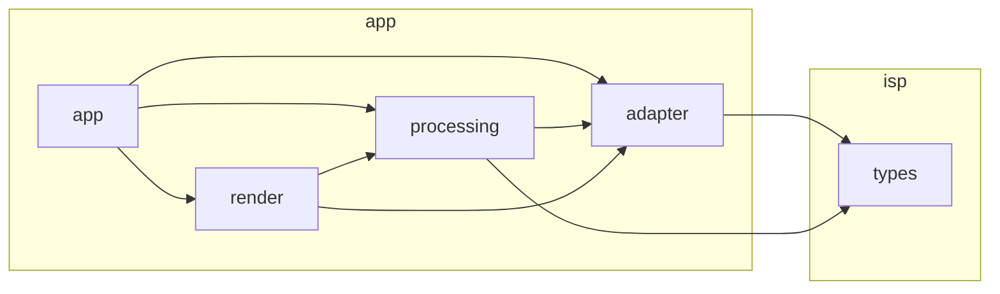

# Architecture

The diagram below is generated from the modules and imports in this repo. Do not edit it by hand. After any module is added or moved, regenerate it:

```
python scripts/gen_architecture.py
```

Solid arrows are Python imports. Dashed arrows are modules the app loads by name through `app/adapter.py`, so that it can start while a pipeline is missing. A module that has not landed does not appear.

<!-- BEGIN GENERATED ARCHITECTURE -->

<!-- END GENERATED ARCHITECTURE -->

## Data contract

All pipelines implement `isp.types.Pipeline`: `run(raw: RawImage) -> PipelineResult`.

- `RawImage.bayer` is a float32 RGGB mosaic, black level removed, in [0, 1].
- `PipelineResult.rgb` is float32 sRGB in [0, 1]. `stages` and `timings_ms` feed the app's stage and latency views.
- Bad user input raises `isp.types.InputError`, whose message is shown to the user.

The planned processing sequence is in [design_document.md](design_document.md), section 2.
