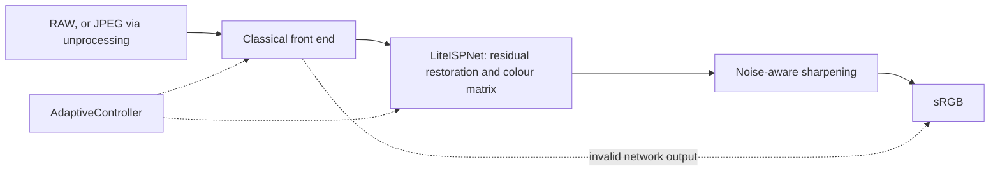

# Design document: Hybrid Smartphone ISP (P2)

**Team ID:** `TXX` | **Members and USNs:** TBD | **Status:** skeleton. Every `TBD-from-results` marker is replaced by a measured value from `results/`, never by an estimate.

> **Assumption about structure.** The organisers provided no design-document template, so this file uses a standard engineering structure: problem, requirements, design, data, evaluation, limitations, ethics. If a template appears, map these sections onto it. See open question 3 in [PRD.md](PRD.md).

Feature IDs (F-CV-1 and so on) refer to the traceability tables in [PRD.md](PRD.md), section 5.

## 1. Problem and goals

The brief asks for a learned smartphone ISP that turns degraded RAW sensor data into high-quality RGB, optimising colour accuracy, noise reduction, sharpness and computational efficiency under mobile constraints. It must be a hybrid: neither a purely classical pipeline nor an off-the-shelf network qualifies, and it must be measurably better than a conventional ISP baseline.

Targets, from PRD section 8. These are goals, not results.

| Metric | Target for the hybrid student (INT8) | Measured |
|---|---|---|
| PSNR, Kodak24 standard conditions | classical baseline + 3 dB | TBD-from-results |
| SSIM | classical baseline + 0.05 | TBD-from-results |
| DeltaE2000 | at most 0.7 x baseline | TBD-from-results |
| LPIPS (AlexNet) | at most 0.7 x baseline | TBD-from-results |
| Parameters and size | under 200 k, at most 0.5 MB | TBD-from-results |
| Latency, 1 MP on 2 vCPU | under 1.5 s end to end | TBD-from-results |
| App response | under 10 s | TBD-from-results |

A missed target stays in this table as missed.

## 2. System overview

Three pipelines implement the same `isp.types.Pipeline` protocol, so the app and the evaluation treat them identically.

| Pipeline | Module | Idea |
|---|---|---|
| Classical | `isp/classical/pipeline.py` | Conventional ISP; the baseline |
| Learned | `isp/learned/pipeline.py` | End-to-end RAW to RGB network (`RawNet`) |
| Hybrid | `isp/hybrid/pipeline.py` | Classical front end, then `LiteISPNet` restoration, then classical sharpening |

The planned hybrid sequence, from PRD section 6:

The module-level diagram generated from the code is in [architecture.md](architecture.md).

## 3. Classical stages

For each stage, record the method chosen, why, and the alternative rejected. The rationale comes from the ablation in section 9.

| Stage | Feature | Method chosen | Why | Evidence |
|---|---|---|---|---|
| Bayer pre-processing | F-CV-1 | TBD | TBD | Unit tests |
| Demosaicing | F-CV-1 | TBD | TBD | TBD-from-results |
| White balance | F-CV-2 | TBD | TBD | TBD-from-results |
| Colour correction | F-CV-3 | TBD | TBD | TBD-from-results |
| Denoising | F-CV-4 | TBD | TBD | TBD-from-results |
| Tone mapping | F-CV-5 | TBD | TBD | Stage visualisation |
| Sharpening | F-CV-6 | TBD | TBD | TBD-from-results |

## 4. Learned components

- **Architecture (F-DL-1):** LiteISPNet, a depthwise-separable U-Net with a global colour-transform head. Input is classical sRGB plus a noise-sigma map. Layer table: TBD.
- **Learned-only baseline:** RawNet, packed Bayer plus sigma to RGB. Layer table: TBD.
- **Restoration and colour (F-DL-3):** residual branch plus a learned 3x3 colour matrix and bias.
- **Loss (F-HY-3):** L1 plus Lab colour loss plus gradient loss. Weights: TBD.
- **Training setup (F-DL-2):** optimiser, schedule, crop size, epochs: TBD. Learning curves: TBD-from-results.
- **Real-RAW fine-tuning:** optional and time-permitting. State whether it was done: TBD.

## 5. Hybrid integration

- **Ordering (F-HY-2):** cheap linear stages stay classical, and the network runs once. Measured per-stage latency: TBD-from-results.
- **Adaptive control (F-AD-1):** `AdaptiveController.decide` maps estimated noise and exposure to denoise strength, sharpening, noise map and model choice. Decision table: TBD.
- **Fallback (F-HY-3):** NaN or Inf network output returns the classical result and sets `info["fallback"]`. The app tells the user when this happens.

## 6. Data

| Split | Source | Count | Use |
|---|---|---|---|
| Train | Urban100, BSD100, Set14, Sun-Hays80, as synthetic RAW | 294 | Training |
| Validation | McMaster | 18 | Checkpoint and hyper-parameter selection only |
| Test | Kodak24 | 24 | Final reporting only, never training or selection |

The synthetic sensor model is unprocessing (Brooks et al., 2019): real-camera CCMs, random illuminants, 0 to -3 EV, Poisson-Gaussian noise and 12-bit quantisation. Test conditions are fixed by seed. Parameter ranges: TBD.

## 7. Optimisation

| Technique | Feature | Params | Size (MB) | Latency 1 MP (ms) | PSNR change (dB) |
|---|---|---|---|---|---|
| Teacher, FP32 | | TBD-from-results | TBD-from-results | TBD-from-results | reference |
| Distilled student, FP32 | F-OPT-1 | TBD-from-results | TBD-from-results | TBD-from-results | TBD-from-results |
| Student, INT8 static PTQ | F-OPT-2 | TBD-from-results | TBD-from-results | TBD-from-results | TBD-from-results |
| Pruning sweep | F-OPT-3 | TBD-from-results | TBD-from-results | TBD-from-results | TBD-from-results |

Source: `results/benchmark.json`, written by `scripts/benchmark.py`.

## 8. Evaluation

Metrics are always reported in this order. Kodak24, standard conditions, from `results/`.

| Pipeline | PSNR | SSIM | DeltaE2000 | LPIPS | Params and size | Latency and memory |
|---|---|---|---|---|---|---|
| Classical | TBD-from-results | TBD-from-results | TBD-from-results | TBD-from-results | none | TBD-from-results |
| Learned | TBD-from-results | TBD-from-results | TBD-from-results | TBD-from-results | TBD-from-results | TBD-from-results |
| Hybrid | TBD-from-results | TBD-from-results | TBD-from-results | TBD-from-results | TBD-from-results | TBD-from-results |

Numbers shown in the app are computed on a preview of at most 2 MP against a user-supplied reference. They are a demonstration, not the results above.

## 9. Robustness, ablation and failure cases

- **Robustness (F-EV-3):** ISO, exposure (0 to -3 EV) and colour-cast sweeps for all three pipelines. Curves: TBD-from-results.
- **Ablation:** no colour head, no noise map, no sharpening, no RAW denoise, AWB variants. Table: TBD-from-results.
- **Failure cases:** at least three, each with the input, the output, what went wrong and why. TBD-from-results.

## 10. Application and deployment

Gradio app in `app/`. The UI depends on the pipelines through one adapter, `app/adapter.py`, which reports anything missing rather than substituting a result.

- **Input:** RAW or JPEG through `isp.io.load_input`. Bad input raises `InputError`, shown as a friendly message.
- **Preview:** mosaics above 2 MP are reduced with 2x2-plane area resampling, which keeps the RGGB phase.
- **Privacy:** see section 12.
- **Hosting:** Docker on Hugging Face Spaces, CPU-only inference, port 7860. Public URL: TBD-from-deployment.

## 11. Limitations

- Synthetic RAW does not capture every real-sensor effect, including fixed-pattern noise, lens shading and crosstalk. Real-RAW results are reported separately and are not over-claimed.
- JPEG input goes through approximate unprocessing. It cannot recover information the camera's own ISP and compression discarded.
- Colour accuracy is measured against a reference rendering, which is itself an aesthetic choice.
- The preview reduces mosaics above 2 MP, and binning lowers noise, so a preview is not the full-resolution result.
- X-Trans and Quad-Bayer sensors, burst HDR and video are out of scope.
- Further limitations from the failure analysis: TBD-from-results.

## 12. Ethics

- Datasets are public research benchmarks. No faces or personal data are collected.
- Uploaded images are not kept. Gradio spools an upload to a temporary file on arrival, so the app reads it into memory and deletes that file immediately. A file uploaded but never developed is removed by a cache sweep within about 20 minutes. Results go to the browser inline and are never written to disk.
- A reference rendering encodes an aesthetic preference, so a colour-accuracy score should not be read as objective truth.
- Learned restoration can invent plausible detail. Outputs are not suitable as evidence of what a scene contained.

## 13. Team and ownership

| Workstream | Directory | Owner |
|---|---|---|
| W1 Classical ISP | `isp/classical/` | TBD |
| W2 Data and real-RAW loaders | `isp/data/`, `isp/io.py` | TBD |
| W3 Learned models and training | `isp/models/`, `isp/learned/` | TBD |
| W4 Hybrid, controller, optimisation | `isp/hybrid/`, `isp/optim/` | TBD |
| W5 Evaluation | `isp/eval/` | TBD |
| W6 App, Docker, docs | `app/`, `Dockerfile`, `docs/` | TBD |

## 14. References

- Brooks et al., *Unprocessing Images for Learned Raw Denoising*, CVPR 2019.
- Malvar, He, Cutler, *High-Quality Linear Interpolation for Demosaicing of Bayer-Patterned Color Images*, ICASSP 2004.
- Ignatov, Van Gool, Timofte, *Replacing Mobile Camera ISP with a Single Deep Learning Model*, CVPRW 2020.
- He, Sun, Tang, *Guided Image Filtering*, TPAMI 2013.
- Foi et al., *Practical Poissonian-Gaussian Noise Modeling and Fitting for Single-Image Raw-Data*, TIP 2008.
- Sharma, Wu, Dalal, *The CIEDE2000 Color-Difference Formula*, Color Research and Application, 2005.
- Zhang et al., *The Unreasonable Effectiveness of Deep Features as a Perceptual Metric*, CVPR 2018.
- Hinton, Vinyals, Dean, *Distilling the Knowledge in a Neural Network*, 2015.
